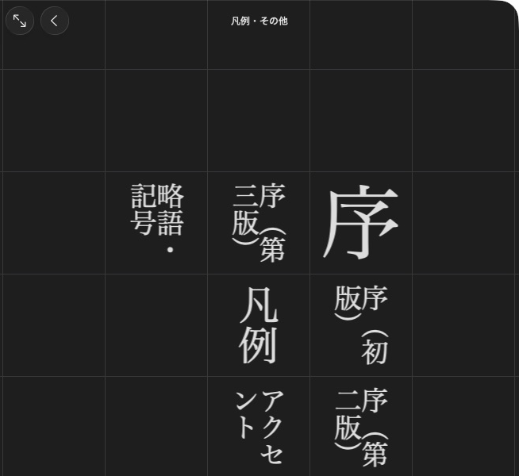

# Add appendices

[](../assets/guide/daijirin-appendices.png)

大辞林 groups reference documents under 凡例・その他.

Use the unfinished writers from [the first dictionary](first_dictionary.md). Add lists and documents, then arrange their menu.

## Add an entry list

=== "Python"

    ```python
    entries = [mkd.AppendixEntry(target, label="鶫", first_character="つ")]
    birbs = dictionary.add_appendix_entries("birbs", "鳥の一覧", entries)
    ```

=== "C++"

    ```cpp
    const std::array<MKD::AppendixEntry, 1> entries{{
        {.entryId = target, .label = "鶫", .firstCharacter = u'つ'},
    }};
    auto birbs = dictionary.addAppendix("birbs", "鳥の一覧", entries).value();
    ```

This writes `appendix/birbs.entries` and registers the list. Each item has an
entry target and optional display label and first-character grouping value.
The first character must fit in one UTF-16 code unit. Supply `rows` and `columns`
when you need a grid. The default is one column with the row count inferred.

Read the finished list through [appendix menus](../reading/appendices.md).

## Register a document appendix

=== "Python"

    ```python
    dictionary.add_asset("appendix/Birds.pdf", mkd.Buffer.map("Birds.pdf"))
    about = dictionary.add_appendix("appendix/Birds.pdf", "この辞典について")
    ```

=== "C++"

    ```cpp
    auto document = MKD::RetainedSpan::map("Birds.pdf").value();
    dictionary.addAsset("appendix/Birds.pdf", document.span()).value();
    auto about = dictionary.addAppendix("appendix/Birds.pdf", "この辞典について").value();
    ```

Registration points to an existing or subsequently added asset. Supported document
extensions are `.html` and `.pdf`. Document appendices are registered in
the product's generated appendix listing. `appendix_entry_lists` exposes binary
entry lists, not document appendices.

## Arrange the product menu

Without an explicit menu, registered appendices appear grouped by dictionary.
Use the returned targets to choose your own sections and submenus:

=== "Python"

    ```python
    product.set_appendices(mkd.AppendixMenu([
        mkd.AppendixSection("鳥を調べる", [
            mkd.AppendixItem("鳥の一覧", birbs),
            mkd.AppendixItem("もっと読む", mkd.AppendixMenu([
                mkd.AppendixSection("", [
                    mkd.AppendixItem("この辞典について", about),
                ]),
            ])),
        ]),
    ]))
    ```

=== "C++"

    ```cpp
    MKD::AppendixMenu more{{{"", {{"この辞典について", about}}}}};
    MKD::AppendixMenu menu{{{"鳥を調べる", {
        {"鳥の一覧", birbs},
        {"もっと読む", std::move(more)},
    }}}};
    product.setAppendices(std::move(menu)).value();
    ```

An empty section name hides its heading. Sections and items keep their supplied
order. `set_appendices` replaces the automatic menu. The library writes submenu
files and validates file and article targets when the product finishes.

Other targets can be passed to `AppendixItem` in the same menu:

=== "Python"

    ```python
    # An allocated article or subentry target, with its content dictionary's ID.
    article = mkd.AppendixEntryLink(target, content.dictionary_id)
    item = mkd.AppendixItem("鶫", article)

    # Product-relative HTML path, with an optional element ID.
    document = mkd.AppendixDocument("birbs/guide.html", fragment="reading")

    # Gallery images must be loose product assets.
    product.add_asset("gallery/tsugumi.png", mkd.Buffer.map("tsugumi.png"))
    gallery = mkd.AppendixGallery(["gallery/tsugumi.png"])
    ```

=== "C++"

    ```cpp
    MKD::AppendixItem item{"鶫", MKD::AppendixEntryLink{target, *content.dictionaryId}};
    MKD::AppendixDocument document{"birbs/guide.html", "reading"};

    auto image = MKD::RetainedSpan::map("tsugumi.png").value();
    product.addAsset("gallery/tsugumi.png", image.span()).value();
    MKD::AppendixGallery gallery{{"gallery/tsugumi.png"}};
    ```

Add the corresponding assets before finishing. Paths in menu targets are relative
to the product's `Contents` directory. Registration through the dictionary writer
returns a target with that prefix already included.

Enable `using_anchor_id` / `usingAnchorId` to group rows by subentry headlines
instead of parent article headlines. Selecting a row follows its full entry target
either way. `single_section` / `singleSection` shows one list without headline grouping:

=== "Python"

    ```python
    compounds = mkd.AppendixList(birbs.path, using_anchor_id=True, single_section=True)
    ```

=== "C++"

    ```cpp
    birbs.usingAnchorId = true;
    birbs.singleSection = true;
    ```

A list row normally targets its owner dictionary. Supply `dictionary_id` /
`dictionaryId` on an `AppendixEntry` to target another dictionary in the product.
Optional item fields provide a description, thumbnail image, or numbered title.
Custom app presenters can be inspected when reading, but cannot be authored.

Next: [Choose article order](order.md).
