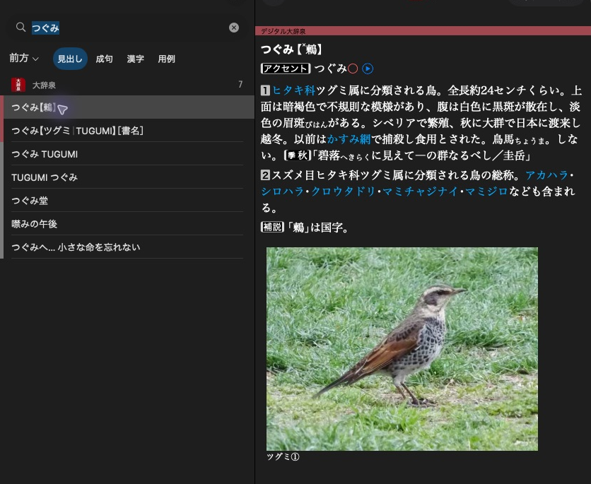

# Create your first dictionary

[](../assets/guide/daijisen-search.png)

大辞泉 shows a headline in the result list and the selected article beside it.

Build a small dictionary with one article about 鶫（つぐみ）. The screenshot
shows the official 大辞泉 article. Our example uses simpler original XML.
Start with a new directory such as `Birds` for `destination`.

Python snippets assume `import mkd`. C++ snippets use `.value()` to keep the API
visible. See [error handling](../reference/errors.md) for application code.

## Create the product and its dictionary

=== "Python"

    ```python
    product = mkd.ProductWriter.create(
        destination,
        mkd.DictionaryMetadata(
            display_name=mkd.LocalizedString(en="Birds", ja="鳥の辞典"),
            version="1.0",
        ),
    )

    dictionary = product.add_dictionary(mkd.DictionaryContent(
        identifier="example.birds.ja",
        directory="ja",
        dictionary_id=1000,
        title=mkd.LocalizedString(ja="鳥の辞典"),
        languages=["ja"],
    ))
    ```

    The dictionary writer retains its product writer automatically.

=== "C++"

    ```cpp
    auto product = MKD::ProductWriter::create(destination, {
        .displayName = MKD::LocalizedString{.en = "Birds", .ja = "鳥の辞典"},
        .version = "1.0",
    }).value();

    auto dictionary = product.addDictionary({
        .identifier = "example.birds.ja",
        .directory = "ja",
        .dictionaryId = 1000,
        .title = MKD::LocalizedString{.ja = "鳥の辞典"},
        .languages = std::vector<std::string>{"ja"},
    }).value();
    ```

    Keep `product` alive while using its dictionary writer.

`destination` is a new product directory, for example `/path/to/Birds`. The writer
refuses an existing destination. This creates one dictionary under `Contents/ja`.

| Value | Purpose |
| --- | --- |
| `Birds` in the destination path | Determines the product identifier `jp.monokakido.Dictionaries.Birds`. |
| `displayName` | Human-readable product name. |
| `identifier` | Stable textual identity for this dictionary's content. |
| `directory` | Content directory name inside `Contents/`. |
| `dictionaryId` | Nonzero 16-bit native dictionary ID. |

Content identifiers, directory names, and numeric dictionary IDs must be unique
within the product. Choose numeric IDs that do not collide with products you
intend to use together. `1000` is an example, not a reserved custom ID.

## Add an article

=== "Python"

    ```python
    article_xml = """<html xmlns="http://www.w3.org/1999/xhtml" hmhtml="5" lang="ja">
    <head><title>鶫</title></head>
    <body><h1>鶫（つぐみ）</h1><p>冬に日本で見られる鳥。</p></body>
    </html>"""

    entry = dictionary.create_entry()
    target = entry.target
    entry.write_xml(article_xml)
    ```

=== "C++"

    ```cpp
    constexpr std::string_view articleXml = R"(<html xmlns="http://www.w3.org/1999/xhtml" hmhtml="5" lang="ja">
    <head><title>鶫</title></head>
    <body><h1>鶫（つぐみ）</h1><p>冬に日本で見られる鳥。</p></body>
    </html>)";

    auto entry = dictionary.createEntry().value();
    const auto target = entry.target();
    entry.writeXml(articleXml).value();
    ```

Supply a complete UTF-8 XML document using the native article markup shown above.
The namespace is part of that markup. `createEntry()` / `create_entry()` allocates
a page ID. `target` refers to the whole article.

## Give the article a headline

=== "Python"

    ```python
    dictionary.add_headline(mkd.HeadlineComponents(
        headline="鶫",
        sorting_headline="つぐみ",
        entry_id=target,
    ))
    ```

    Headline fields accept Python strings and convert them automatically.

=== "C++"

    ```cpp
    dictionary.addHeadline({
        .headline = u"鶫",
        .sortingHeadline = u"つぐみ",
        .entryId = target,
    }).value();
    ```

    Headline fields use UTF-16.

Every page needs a primary headline. `sortingHeadline` / `sorting_headline`
controls headline ordering. Neither field comes from the XML heading.

## Add spelling and reading keys

=== "Python"

    ```python
    dictionary.add_search_key(mkd.SearchScope.HEADWORD, "鶫", target)
    dictionary.add_search_key(mkd.SearchScope.HEADWORD, "つぐみ", target)
    ```

=== "C++"

    ```cpp
    dictionary.addSearchKey(MKD::SearchScope::Headword, "鶫", target).value();
    dictionary.addSearchKey(MKD::SearchScope::Headword, "つぐみ", target).value();
    ```

Search keys use UTF-8. Both keys point to the same article. Neither the headline
nor `sortingHeadline` automatically adds search keys. The writer normalises
these keys using its supported default native profile.

## Add copyright information

=== "Python"

    ```python
    product.set_information(mkd.ProductInformation(
        copyright=mkd.LocalizedString(ja="© 2026 鳥の辞典編集室"),
    ))
    ```

=== "C++"

    ```cpp
    product.setInformation({
        .copyright = MKD::LocalizedString{.ja = "© 2026 鳥の辞典編集室"},
    }).value();
    ```

The writer generates the product information page. You can add
[licenses and custom pages](information.md) later.

## Publish the files

=== "Python"

    ```python
    dictionary.finish()
    product.finish()
    ```

=== "C++"

    ```cpp
    dictionary.finish().value();
    product.finish().value();
    ```

Finish each dictionary before the product. `product.finish()` validates the
build and publishes its folder at `destination`. Abandoning a writer does not
publish anything. See [finishing and validation](publishing.md) for details.

## Try the dictionary

[Install the finished product](publishing.md#install-and-replace) in Dictionaries
on macOS, then search for `つぐみ` or `鶫`. You can also [open and search it with
the library](../searching/queries.md).

The [birb example project](https://github.com/kiwakiwaa/mkd-tools/tree/main/examples/birbs)
shows a larger general dictionary, a kanwa dictionary and a field guide.

Next: [Set product information and licenses](information.md).
