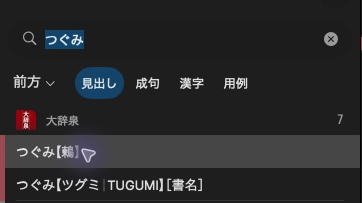

# Define headlines

[](../assets/guide/daijisen-headlines.png)

大辞泉 displays つぐみ【鶫】 in the result list.

The result-list headline and its ordering text are separate from the article’s XML heading. Use an allocated `target`.

## Give the article a headline

=== "Python"

    ```python
    dictionary.add_headline(mkd.HeadlineComponents(
        headline="鶫",
        sorting_headline="つぐみ",
        entry_id=target,
    ))
    ```

    Headline fields accept Python strings and convert them automatically.

=== "C++"

    ```cpp
    dictionary.addHeadline({
        .headline = u"鶫",
        .sortingHeadline = u"つぐみ",
        .entryId = target,
    }).value();
    ```

    Headline fields use UTF-16.

Every page needs a primary headline. `sortingHeadline` / `sorting_headline`
controls headline ordering. Neither field comes from the XML heading.

## Add an alternative headline

=== "Python"

    ```python
    dictionary.add_headline(
        mkd.HeadlineComponents("つぐみ", target), role=mkd.HeadlineRole.SHORT,
    )
    ```

=== "C++"

    ```cpp
    dictionary.addHeadline({.headline = u"つぐみ", .entryId = target}, MKD::HeadlineRole::Short).value();
    ```

Primary, secondary and short headlines are stored separately for native consumers
to select. An alternative label does not replace the required primary headline or
add a search key. Use `HeadlineRole::Secondary` / `HeadlineRole.SECONDARY` for the
secondary store.

Primary headlines are also used by entry lists and navigation items without
explicit labels. Prefix and suffix fields add text around the main headline.
They do not add searchable spellings. Use [search keys](search_keys.md) for that.

Next: [Add search keys](search_keys.md).
