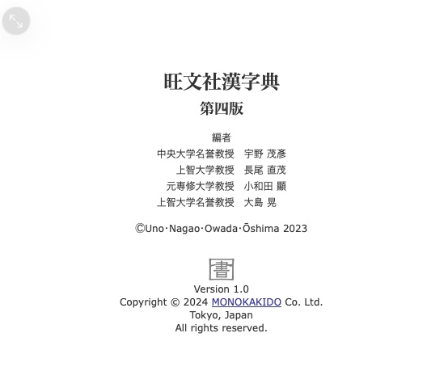
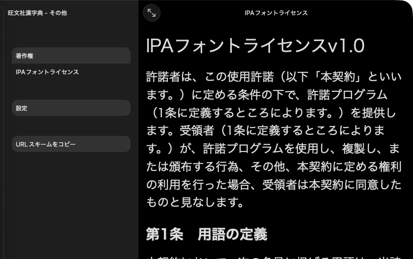

# Product information and licenses

[](../assets/guide/kjt-information.png)

旺文社漢字典 presents its title, edition, editors and copyright through その他 → 著作権.

Choose the metadata when starting your build. The setup below replaces the
product setup in [the first dictionary](first_dictionary.md). Add copyright and
licenses before finishing. The library generates their pages and menu.

## Set the product and content metadata

Pass product fields when creating the product. Pass publisher and edition when
adding its dictionary:

=== "Python"

    ```python
    metadata = mkd.DictionaryMetadata(
        display_name=mkd.LocalizedString(ja="鳥の辞典"),
        product_title=mkd.LocalizedString(ja="鳥の辞典"),
        description=mkd.LocalizedString(ja="身近な鳥のことば。"),
        version="1.0",
    )
    content = mkd.DictionaryContent(
        identifier="example.birds.ja",
        directory="ja",
        dictionary_id=1000,
        title=mkd.LocalizedString(ja="鳥の辞典"),
        languages=["ja"],
        publisher=mkd.LocalizedString(ja="鳥の辞典編集室"),
        edition=mkd.LocalizedString(ja="初版"),
    )
    product = mkd.ProductWriter.create(destination, metadata)
    dictionary = product.add_dictionary(content)
    ```

=== "C++"

    ```cpp
    auto product = MKD::ProductWriter::create(destination, {
        .displayName = MKD::LocalizedString{.ja = "鳥の辞典"},
        .description = MKD::LocalizedString{.ja = "身近な鳥のことば。"},
        .productTitle = MKD::LocalizedString{.ja = "鳥の辞典"},
        .version = "1.0",
    }).value();
    auto dictionary = product.addDictionary({
        .identifier = "example.birds.ja", .directory = "ja", .dictionaryId = 1000,
        .title = MKD::LocalizedString{.ja = "鳥の辞典"},
        .publisher = MKD::LocalizedString{.ja = "鳥の辞典編集室"},
        .edition = MKD::LocalizedString{.ja = "初版"},
        .languages = std::vector<std::string>{"ja"},
    }).value();
    ```

The generated page uses the product title, description, content titles,
publishers, editions and version. `LocalizedString` accepts Japanese, English or
both. `display_name` / `displayName` names the product in the collection.

## Supply copyright and licenses

[](../assets/guide/kjt-license.png)

KJT lists its IPA font license separately from its copyright page.

Read your license text into `license_text` / `licenseText`, then register it:

=== "Python"

    ```python
    product.set_information(mkd.ProductInformation(
        copyright=mkd.LocalizedString(ja="© 2026 鳥の辞典編集室"),
        licenses=[mkd.ProductLicense("Font license", license_text)],
    ))
    ```

=== "C++"

    ```cpp
    product.setInformation({
        .copyright = MKD::LocalizedString{.ja = "© 2026 鳥の辞典編集室"},
        .licenses = {{.title = "Font license", .text = licenseText}},
    }).value();
    ```

The native その他 tab includes copyright, license pages and settings.
For a custom information page, set `ProductInformation.page` to the path of a
product asset added with `addAsset` / `add_asset`. Each license also accepts a
`page` override. Paths are relative to the product's `Contents/` directory.
Custom pages must exist before `finish()`.

## Supply a custom page

=== "Python"

    ```python
    product.add_asset("credits.html", mkd.Buffer.map("credits.html"))
    product.set_information(mkd.ProductInformation(page="credits.html"))
    ```

=== "C++"

    ```cpp
    auto credits = MKD::RetainedSpan::map("credits.html").value();
    product.addAsset("credits.html", credits.span()).value();
    product.setInformation({.page = "credits.html"}).value();
    ```

A custom page replaces the generated information page. `set_information()` /
`setInformation()` replaces the whole information object, so supply licenses in
the same call when needed. Product assets are relative to `Contents/`.

Next: [Add a product icon](icons.md).
