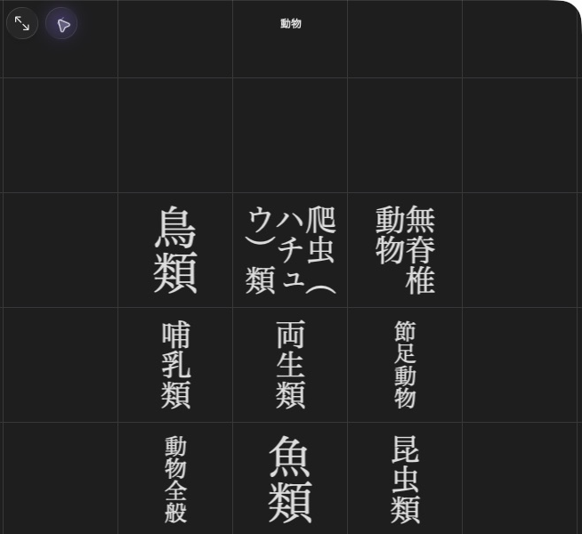
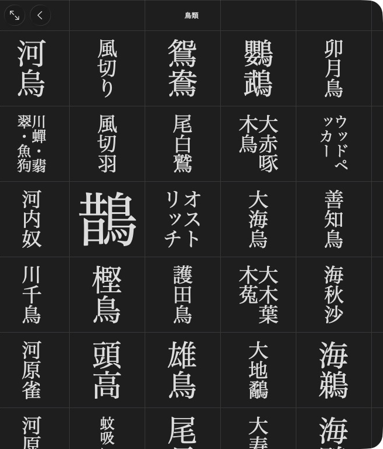

# Build category navigation

[](../assets/guide/daijirin-categories.png)

大辞林’s 動物 index opens narrower categories such as 鳥類.

Use the general creation profile and the allocated entry targets from your unfinished dictionary.

## Make an entry grid

[](../assets/guide/daijirin-birbs.png)

The 鳥類 grid opens individual articles.

=== "Python"

    ```python
    birbs = mkd.NavigationIndex(sections=[
        mkd.NavigationSection(items=[
            mkd.NavigationItem(label="鶫", target=tsugumi.target),
            mkd.NavigationItem(label="雀", target=suzume.target),
        ]),
    ])
    product.set_navigation(birbs)
    ```

=== "C++"

    ```cpp
    MKD::NavigationIndex birbs{.sections = {{"", {
        {"鶫", MKD::AppendixEntryLink{tsugumi.target(), dictionaryId}},
        {"雀", MKD::AppendixEntryLink{suzume.target(), dictionaryId}},
    }}}};
    product.setNavigation(birbs).value();
    ```

`tsugumi` and `suzume` are entries created through `create_entry()` / `createEntry()`.
Python entry targets default to the product's first dictionary. C++ uses
`AppendixEntryLink` with its numeric dictionary ID.

## Put the grid inside a category

=== "Python"

    ```python
    product.set_navigation(mkd.NavigationIndex(sections=[
        mkd.NavigationSection(items=[mkd.NavigationItem(label="鳥類", target=birbs)]),
    ]))
    ```

=== "C++"

    ```cpp
    product.setNavigation({.sections = {{"", {{"鳥類", birbs}}}}}).value();
    ```

Each item can open an article, subentry, child index or document. Empty labels
use the target headline. An empty target leaves a spacer. An untitled section
places its items directly in the grid. A titled section becomes a submenu.

`rows` and `columns` set the grid dimensions, with automatic sizing when omitted.
`vertical=False` / `vertical = false` selects horizontal child grids.
`shorten_headlines` / `shortenHeadlines` selects shorter headlines for entry lists.

Setting navigation changes the app’s 付録 tab to インデックス. Existing appendices
remain under 付録 in the generated index. The writer generates the index files.

Next: [Build kanwa indexes](kanwa_navigation.md).
