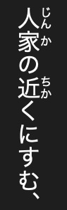

# Add ruby

[](../assets/guide/rgko-ruby.png)

例解学習国語 places readings beside kanji throughout its 雀 article.

Use an unfinished dictionary writer and add the fragment before writing the article XML.

## Add ruby

=== "Python"

    ```python
    label = mkd.InlineText()
    label.append(mkd.Ruby("鶫", "つぐみ"))
    ```

=== "C++"

    ```cpp
    MKD::InlineText label;
    label.append(MKD::Ruby{"鶫", "つぐみ"});
    ```

The ruby pairs the written form 鶫 with its reading つぐみ.

## Use the formatted text

After assembling the label, encode it for the intended destination:

=== "Python"

    ```python
    fragment = label.to_xml()
    headline = label.to_headline()
    ```

=== "C++"

    ```cpp
    auto fragment = label.toXhtml().value();
    auto headline = label.toHeadline().value();
    ```

Insert `fragment` into article XML before writing it. Use `headline` as a
`HeadlineComponents` headline. XML ruby uses `<ruby><rb>鶫</rb><rt>つぐみ</rt></ruby>`.
Headlines use a separate headline command encoding.

## Configure full-ruby presentation

=== "Python"

    ```python
    dictionary.add_asset("ruby.css", mkd.Buffer.map("ruby.css"))
    dictionary.set_presentation(mkd.DictionaryPresentation(full_ruby_stylesheet="ruby.css"))
    ```

=== "C++"

    ```cpp
    auto css = MKD::RetainedSpan::map("ruby.css").value();
    dictionary.addAsset("ruby.css", css.span()).value();
    dictionary.setPresentation({.fullRubyStylesheet = "ruby.css"}).value();
    ```

This records the stylesheet for the full-ruby presentation in Dictionaries. It controls
readings already in the article XML. See [Ruby presentation](../reference/layout_examples.md#ruby-presentation)
for the CSS. Finish the dictionary and product as in [the first dictionary](first_dictionary.md).

The generic kanwa headline formatter does not interpret general ruby headline
tokens. Keep its compound headlines as plain text and use ruby in article XML.

Next: [Add gaiji](gaiji.md).
