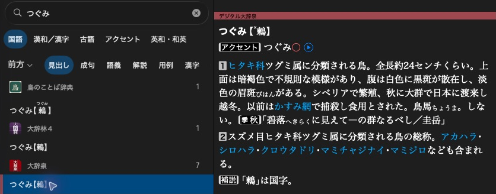

[Documentation](README.md)

# Core concepts

## Products and dictionaries

A product is an installed package, such as 大辞泉. It can contain one or more
dictionaries, each with its own articles, search indexes and resources.

```text
DAIJISEN2/                      # Product root passed to DictionaryProduct::openAtPath()
├── ContentInfo.plist           # Identifies the installed product
└── Contents/
    ├── DAIJISEN2.json          # Product metadata, including its dictionaries
    └── Shogakukan-DJS/         # One dictionary's content directory
        ├── DSContentInfo.plist # Metadata for this dictionary
        ├── contents/           # Article XML stored in resource files
        ├── headline/           # Display labels and sorting text
        ├── key/                # Search indexes connecting keys to entry IDs
        ├── graphics/           # Images referenced by the content
        └── gaiji/              # Character images
```

`DAIJISEN2` is the product folder. `DAIJISEN.J` is the content identifier used
to select its dictionary through the API. `Shogakukan-DJS` is that dictionary's
content directory. The writer creates this layout for you.

## Articles, headlines and search keys

Searching for ”つぐみ” in 大辞泉 finds an article about 鶫. The app shows a
headline in the result list and the article beside it.



These are stored separately:

- The article is an XML document containing the displayed text and markup.
- The headline is the label shown in a result list.
- Search keys are spellings or readings that lead to the article.

Here is a shortened excerpt from that article's XML:

```xml
<見出G>
  <headword class="見出">つぐみ</headword>
  <headword class="表記">…鶫…</headword>
  …
</見出G>
<解説G>
  <MG id="244295-C001" class="L3">
    <meaning>…ヒタキ科ツグミ属に分類される鳥。…</meaning>
  </MG>
  …
</解説G>
```

The tag names and CSS belong to 大辞泉. Your own dictionary can use simpler XML.
An XML heading does not create a result-list headline or searchable keys.
Authors supply all three.

Each article has a page ID. A search result carries a target identifying the
article and, when needed, a passage within it. Several keys can lead to the same
target. One key can also find several articles, such as the bird and the book
called つぐみ.

## Resources

Articles can refer to images, audio, fonts and stylesheets stored with the
dictionary. Gaiji are character images used where ordinary text is insufficient.
The reading and creation guides show how to access or add these resources.

Next: [Reading dictionaries](reading/browsing.md).
