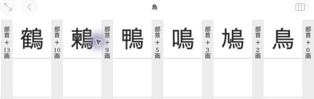

# Navigation, appendices and entry order

These snippets extend the writer in [Creating a dictionary](minimal_dictionary.md),
before either `finish()` call.

## Add an entry list

=== "Python"

    ```python
    entries = [mkd.AppendixEntry(target, label="鶫", first_character="つ")]
    birbs = dictionary.add_appendix_entries("birbs", "鳥の一覧", entries)
    ```

=== "C++"

    ```cpp
    const std::array<MKD::AppendixEntry, 1> entries{{
        {.entryId = target, .label = "鶫", .firstCharacter = u'つ'},
    }};
    auto birbs = dictionary.addAppendix("birbs", "鳥の一覧", entries).value();
    ```

This writes `appendix/birbs.entries` and registers the list. Each item has an
entry target and optional display label and first-character grouping value.
The first character must fit in one UTF-16 code unit. Supply `rows` and `columns`
when you need a grid. The default is one column with the row count inferred.

After finishing and reopening the product, select its dictionary as
`openedDictionary` / `opened_dictionary`. Lists are available through `appendixEntryLists()` /
`appendix_entry_lists`. Read individual items with `entryAt(i)` / `entry_at(i)`.
C++ returns an `AppendixEntryView` whose label borrows the list. Call `copy()`
to obtain an owning `AppendixEntry` that can outlive it. Python returns the
owning value automatically.

=== "Python"

    ```python
    appendix = opened_dictionary.appendix_entry_lists[0]
    owned = appendix.entry_at(0)
    ```

=== "C++"

    ```cpp
    const auto& list = openedDictionary.appendixEntryLists().front();
    const auto view = list.entryAt(0).value();
    auto owned = view.copy();
    ```

## Register a document appendix

=== "Python"

    ```python
    dictionary.add_asset("appendix/Birds.pdf", mkd.Buffer.map("Birds.pdf"))
    about = dictionary.add_appendix("appendix/Birds.pdf", "この辞典について")
    ```

=== "C++"

    ```cpp
    auto document = MKD::RetainedSpan::map("Birds.pdf").value();
    dictionary.addAsset("appendix/Birds.pdf", document.span()).value();
    auto about = dictionary.addAppendix("appendix/Birds.pdf", "この辞典について").value();
    ```

Registration points to an existing or subsequently added asset. Supported document
extensions are `.html` and `.pdf`. Document appendices are registered in
the product's generated appendix listing. `appendix_entry_lists` exposes binary
entry lists, not document appendices.

## Arrange the product menu

Without an explicit menu, registered appendices appear grouped by dictionary.
Use the returned targets to choose your own sections and submenus:

=== "Python"

    ```python
    product.set_appendices(mkd.AppendixMenu([
        mkd.AppendixSection("鳥を調べる", [
            mkd.AppendixItem("鳥の一覧", birbs),
            mkd.AppendixItem("もっと読む", mkd.AppendixMenu([
                mkd.AppendixSection("", [
                    mkd.AppendixItem("この辞典について", about),
                ]),
            ])),
        ]),
    ]))
    ```

=== "C++"

    ```cpp
    MKD::AppendixMenu more{{{"", {{"この辞典について", about}}}}};
    MKD::AppendixMenu menu{{{"鳥を調べる", {
        {"鳥の一覧", birbs},
        {"もっと読む", std::move(more)},
    }}}};
    product.setAppendices(std::move(menu)).value();
    ```

An empty section name hides its heading. Sections and items keep their supplied
order. `set_appendices` replaces the automatic menu. The library writes submenu
files and validates file and article targets when the product finishes.

Other generic targets:

=== "Python"

    ```python
    # An allocated article or subentry target, with its content dictionary's ID.
    article = mkd.AppendixEntryLink(target, content.dictionary_id)
    item = mkd.AppendixItem("鶫", article)

    # Product-relative HTML path, with an optional element ID.
    document = mkd.AppendixDocument("birbs/guide.html", fragment="reading")

    # Gallery images must be loose product assets.
    product.add_asset("gallery/tsugumi.png", mkd.Buffer.map("tsugumi.png"))
    gallery = mkd.AppendixGallery(["gallery/tsugumi.png"])
    ```

=== "C++"

    ```cpp
    MKD::AppendixItem item{"鶫", MKD::AppendixEntryLink{target, *content.dictionaryId}};
    MKD::AppendixDocument document{"birbs/guide.html", "reading"};

    auto image = MKD::RetainedSpan::map("tsugumi.png").value();
    product.addAsset("gallery/tsugumi.png", image.span()).value();
    MKD::AppendixGallery gallery{{"gallery/tsugumi.png"}};
    ```

Add the corresponding assets before finishing. Paths in menu targets are relative
to the product's `Contents` directory. Registration through the dictionary writer
returns a target with that prefix already included.

For lists of subentries, enable `using_anchor_id` / `usingAnchorId`. Otherwise the
native app opens their parent articles. `single_section` / `singleSection` shows
one list without headline grouping:

=== "Python"

    ```python
    compounds = mkd.AppendixList(birbs.path, using_anchor_id=True, single_section=True)
    ```

=== "C++"

    ```cpp
    birbs.usingAnchorId = true;
    birbs.singleSection = true;
    ```

A list row normally targets its owner dictionary. Supply `dictionary_id` /
`dictionaryId` on an `AppendixEntry` to target another dictionary in the product.
Optional item fields provide a description, thumbnail image, or numbered title.
Custom app presenters can be inspected when reading, but cannot be authored.

## Add native index navigation

`set_navigation()` replaces the app's 付録 tab with インデックス. Existing
appendices remain reachable under 付録 in the new menu. The general creation
profile produces category grids like 大辞林. The kanwa profile produces the
sectioned grid/list browser used by kanwa dictionaries.

Each item opens an article, a child index or a document. Use the allocated targets
from [Subentries and links](subentries.md), including compound targets.

=== "Python"

    ```python
    members = mkd.NavigationIndex(sections=[
        mkd.NavigationSection("部首 ＋ 0画", [mkd.NavigationItem(target=tori.target)]),
        mkd.NavigationSection("部首 ＋ 3画", [mkd.NavigationItem(target=naku.target)]),
    ], section_index=False)
    radicals = mkd.NavigationIndex(
        kind=mkd.NavigationKind.RADICALS,
        sections=[mkd.NavigationSection("11画", [mkd.NavigationItem(
            label=mkd.RadicalLabel("鳥", reading="とり・とりへん"),
            target=members,
        )])],
    )
    product.set_navigation(mkd.NavigationIndex(sections=[
        mkd.NavigationSection("親字", [mkd.NavigationItem(label="部首", target=radicals)]),
    ]))
    ```

=== "C++"

    ```cpp
    MKD::NavigationIndex members{
        .sections = {
            {"部首 ＋ 0画", {{.target = MKD::AppendixEntryLink{tori.target(), dictionaryId}}}},
            {"部首 ＋ 3画", {{.target = MKD::AppendixEntryLink{naku.target(), dictionaryId}}}},
        },
        .sectionIndex = false,
    };
    MKD::NavigationIndex radicals{
        .kind = MKD::NavigationKind::Radicals,
        .sections = {{"11画", {{
            .label = MKD::RadicalLabel{.character = "鳥", .reading = "とり・とりへん"},
            .target = std::move(members),
        }}}},
    };
    product.setNavigation({.sections = {{"親字", {{"部首", std::move(radicals)}}}}}).value();
    ```

This kanwa example opens 部首 → 鳥 → entries grouped by additional strokes.
`RadicalLabel` arranges the character, optional variants and reading in the native
cell. It is only available in the kanwa profile.



Kanwa `kind` selects native presentation:

| Kind | Author supplies |
| --- | --- |
| `GENERIC` | Any named groups or entry lists |
| `RADICALS` | Radical stroke groups, radicals, then additional-stroke entry groups |
| `READINGS` | Reading groups and matching entries |
| `TOTAL_STROKES` | Numeric labels such as `"11"`, then matching entries. The app adds 画 |
| `CLASSIFICATIONS`, `NAMES` | Named categories and their entries |

For general dictionaries, use `GENERIC`. An untitled section places its items
directly in the grid. A titled section becomes a submenu. `rows` and `columns`
set grid dimensions, with automatic sizing when omitted. An item without a target
leaves a blank grid cell. `vertical=False` selects horizontal child grids.

Kanwa sections show their titles above entry groups. `compact=True` uses smaller
cells. `section_index=False` hides the jump strip, which can truncate long section
titles. For items without explicit labels, `parent_headlines=True` displays main-entry headlines while preserving
subentry destinations.

`AppendixDocument` and `AppendixList` targets can also appear in navigation.
Cross-dictionary article targets use `AppendixEntryLink(target, dictionary_id)`.
Native files, offsets and controller classes are generated internally. Specialised
product controllers are outside the authoring profiles.

## Add an alternative headline

=== "Python"

    ```python
    dictionary.add_headline(
        mkd.HeadlineComponents("つぐみ", target), role=mkd.HeadlineRole.SHORT,
    )
    ```

=== "C++"

    ```cpp
    dictionary.addHeadline({.headline = u"つぐみ", .entryId = target}, MKD::HeadlineRole::Short).value();
    ```

Primary, secondary and short headlines are stored separately for native consumers
to select. An alternative label does not replace the required primary headline or
add a search key. Use `HeadlineRole::Secondary` / `HeadlineRole.SECONDARY` for the
secondary store.

## Choose browsing order

In the two-article dictionary below, show 雀 before 鶫.

=== "Python"

    ```python
    sparrow = dictionary.create_entry()
    sparrow_target = sparrow.target
    sparrow.write_xml("""<html xmlns="http://www.w3.org/1999/xhtml" hmhtml="5">
      <head><title>雀</title></head>
      <body><h1>雀</h1></body>
    </html>""")
    dictionary.add_headline(mkd.HeadlineComponents("雀", sparrow_target))
    dictionary.add_search_key(mkd.SearchScope.HEADWORD, "すずめ", sparrow_target)
    dictionary.set_entry_order([sparrow_target.page_id, target.page_id])
    ```

=== "C++"

    ```cpp
    auto sparrow = dictionary.createEntry().value();
    const auto sparrowTarget = sparrow.target();
    sparrow.writeXml(R"(<html xmlns="http://www.w3.org/1999/xhtml" hmhtml="5">
      <head><title>雀</title></head>
      <body><h1>雀</h1></body>
    </html>)").value();
    dictionary.addHeadline({.headline = u"雀", .entryId = sparrowTarget}).value();
    dictionary.addSearchKey(MKD::SearchScope::Headword, "すずめ", sparrowTarget).value();
    const std::array order{sparrowTarget.pageId, target.pageId};
    dictionary.setEntryOrder(order).value();
    ```

An explicit order must contain every page ID exactly once. The default is
ascending page ID. This writes native browsing order. It does not reorder search
results or the resource-store iteration sequence.

Finish the dictionary and product after adding the desired content.

After reopening, use [browsing order](../reading/browsing.md#follow-browsing-order)
to retrieve this sequence or find the previous and next article.
