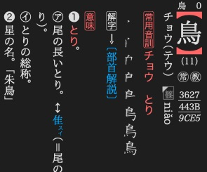
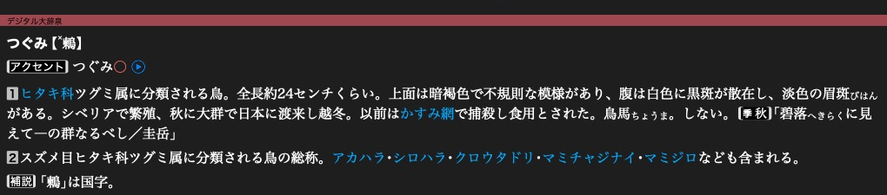
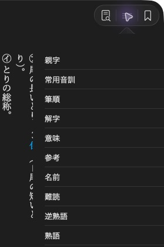

# Styling articles

After [adding a stylesheet](resources.md#add-stylesheets-and-loose-assets), use it
to style your article XML. Dictionaries renders articles with its own
layout engine. A browser preview will not reproduce all of these features.
For lookup, see the [CSS reference](../reference/article_css.md) and
[mathematical notation](../reference/mathematics.md), with rendered results.

## Start with the article layout

```css
body {
    margin: 1em;
    font-size: 1.2em;
    line-height: 1.5em;
}

meaning { display: block; }
```

Custom XML elements start inline. Give sections `display: block` when they should
start a new paragraph. Use `em` for spacing that follows the reader's text size.

## Vertical writing and horizontal groups

```xml
<body>
    <p>鳥は<Tc>11</Tc>画。</p>
</body>
```

```css
body { writing-mode: vertical-rl; }
Tc { text-combine-horizontal: all; }
```

`vertical-rl` lays out columns from right to left. `text-combine-horizontal`
keeps a short group upright within the column, as in 縦中横. Use `none` when the
text should follow the normal vertical flow.



旺文社漢字典「鳥」. The stroke count stays together within the vertical layout.

## Compact readings with warichu

```xml
蒼頡<mlg>ソウケツ・ ソウキツ</mlg>
```

```css
mlg {
    display: warichu;
    font-size: 0.5em;
}
```

Warichu divides a short annotation into two compact lines. It is useful for
readings and parenthetical notes. It is separate from ruby, which attaches a
reading to base text.


旺文社漢字典「鳥跡・鳥迹」, within「鳥」. Both readings fill the two small columns.

## Images that behave like text

```xml

```

```css
img.字韻 {
    display: gaiji;
    height: 1.1em;
    text-combine-horizontal: all;
}
```

`display: gaiji` gives an image text-like placement. Set its height in `em` to
follow the surrounding font size. Monochrome gaiji can follow the text colour,
including night-mode colours. Keep ordinary illustrations as ordinary images.


旺文社漢字典「鳥」. The small image beside `niǎo` is an inline gaiji.
For your own glyphs, use [gaiji registration](inline_content.md#register-a-gaiji-image).

## Mathematical expressions

```xml
<math>\frac{a}{b}</math>
```

```css
math {
    display: math;
    text-combine-horizontal: all;
}
```

The layout engine passes the formula text to its mathematical renderer. This example draws
a fraction. The input is formula notation, rather than a MathML element tree.


大辞林「分数」. Both fractions remain upright within the vertical text.

## Hanging markers

```xml
<p><M_hang>▽</M_hang>鳥の読みから項目を探します。</p>
```

```css
M_hang {
    display: hang;
    margin-right: 0.2em;
    color: okg-red;
}
```

`display: hang` puts a marker outside the paragraph's text edge. Wrapped lines
align with the text rather than the marker. Here `okg-red` is a named colour,
[defined below](#colours-and-night-presentation).


旺文社古語辞典「和歌・俳句索引」. The ▽ markers sit outside the text columns.

## Arrow-shaped labels

```xml
<M_mark class="組成">組成</M_mark>
```

```css
M_mark.組成 {
    border: solid 1px black;
    border-shape: arrow-box;
    padding-right: 0.5em;
}
```

`border-shape: arrow-box` turns the label's border into an arrow-shaped outline.
Use `arrow-box-rl` for the opposite arrow direction.


旺文社古語辞典「あ【案】」.

## Pitch-accent marks

```xml
ミ<sl>ズサ</sl>エ
```

```css
sl { text-decoration: accent; }
```

`text-decoration: accent` draws a line along the high-pitch part, with a short
stroke marking the drop at its end. The line follows the writing direction.


大辞林「文節・活用形のアクセント例」. The line marks ズサ in ミズサエ.

## Font glyphs and features

### Select a glyph

```xml
<accent0>⓪</accent0>
```

```css
accent0 { glyph: 11307; }
```

`glyph` selects a glyph number in the current font. 新明解 uses this for its
accent symbols. The number is font-specific, not a Unicode code point. Prefer
ordinary Unicode or [gaiji](inline_content.md) unless you control the font.


新明解国語辞典「鶫」. The boxed zero is selected by `glyph`.

### Select a font feature

```xml
「<ital>x</ital>の値を求める」
```

```css
ital { glyph-form: ital; }
```

`glyph-form` selects an OpenType feature by its four-character tag. The font
must provide that feature. Installed dictionaries also use `jp90` for Japanese
character forms.


旺文社国語辞典「値・価」. The variable `x` uses the font's italic form.

## Colours and night presentation

Define a colour name once, then use it in text, backgrounds and borders:

```css
/* Birds.css */
@color okg-red = #E4007F;
M_hang { color: okg-red; }
```

Override that name in the sibling night stylesheet:

```css
/* Birds-nightmode.css */
@color okg-red = #FF80B0;
```

The layout engine adds the night stylesheet when night presentation is active. It also has
its own night palette for names such as `black` and `blue`.



大辞泉「鶫」 in night presentation. Its named header, accent and link colours
remain distinct from the article text.

## Ruby presentation

Ruby markup comes from [Gaiji and ruby](inline_content.md#add-ruby). Style its
reading with the native display rules:

```css
rt {
    display: ruby-text;
    font-size: 0.55em;
}
```

To hide optional readings in the normal stylesheet, use `rt { display: none; }`.
A [full-ruby stylesheet](inline_content.md#configure-full-ruby-presentation) can
restore `display: ruby-text` when the reader enables that presentation. It styles
readings already in the XML, it does not generate them.

## The article section menu

`entry-index` supplies the app's section menu even when it is hidden in the
article. Its links point to [allocated section targets](subentries.md).

```xml
<entry-index>
    <a href="08721-C001">親字</a>
    <a href="08721-C005">意味</a>
</entry-index>
```

```css
entry-index { display: none; }
```



旺文社漢字典「鳥」. The app presents these links through its menu button.
Use the target handles from your writer instead of copying the example's IDs.

## Notes

- The layout engine skips `@media` blocks.
- Register fonts through the writer and select their internal font name with
  `font-family`. Article `@font-face` rules are not processed.
- `ruby-position` is not processed. Use ruby markup and the display rules above.
- Browser layout features such as flexbox, grid and CSS variables are not
  supported by this article parser. Start with blocks, inline text and tables.
- Check long text and both writing directions in the app. Small gaiji, compact
  readings and fixed-size labels need enough space at the reader's chosen size.

Next: [Appendices and entry order](navigation.md).
