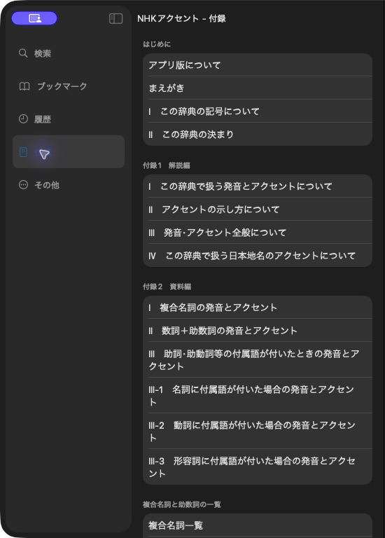

# Read appendix menus

[](../assets/guide/nhk-appendices.png)

NHKアクセント groups guides and entry lists in its 付録 menu. Use an open `product`.

## Read sections and items

=== "Python"

    ```python
    for section in product.appendices.sections:
        for item in section.items:
            print(section.name, item.name)
    ```

=== "C++"

    ```cpp
    for (const auto& section : product.appendices().sections)
        for (const auto& item : section.items)
            std::cout << section.name << ": " << item.name << '\n';
    ```

Sections and items keep native menu order. An empty section name means no heading.
Choose an `item` from this menu before using the following snippets.

## Open a list or document

=== "Python"

    ```python
    if isinstance(item.target, mkd.AppendixList):
        entries = product.open_appendix_list(item.target)
        if len(entries):
            first = entries.entry_at(0)
    elif isinstance(item.target, mkd.AppendixDocument):
        data = product.open_appendix_document(item.target)
    ```

=== "C++"

    ```cpp
    if (const auto* list = std::get_if<MKD::AppendixList>(&item.target)) {
        auto entries = product.openAppendixList(*list).value();
        if (entries.size()) {
            auto first = entries.entryAt(0).value();
            auto owned = first.copy();
        }
    } else if (const auto* document = std::get_if<MKD::AppendixDocument>(&item.target)) {
        auto data = product.openAppendixDocument(*document).value();
    }
    ```

Check the list is nonempty before reading a row. Python returns an owning entry.
C++ entry views borrow the list, while `copy()` makes an owning value.

Documents may be HTML or PDF. Their retained bytes can outlive the product.
`fragment` identifies an HTML element to scroll to.

## Follow other targets

| Target | How to follow it |
| --- | --- |
| `AppendixMenu` | Read its `sections` just like the root menu |
| `AppendixEntryLink` | Find the owner through `product.find_content(dictionary_id)`, then read the target’s page |
| `AppendixGallery` | Read the product-relative paths in `images` through `product.resource(path)` |
| `AppendixCustom` | Inspect the recorded fields. An app-specific presenter may be required |

C++ uses `findContent()` and the same target types. Keep a link’s full entry ID
when it points inside an article. Labels may contain native headline markup.

Products without `Appendix.plist` have an empty menu. Category grids and kanwa
radical screens use the separate [navigation API](navigation.md).
For writing these menus, see [Add appendices](../authoring/appendices.md).

Next: [Follow article order](order.md).
