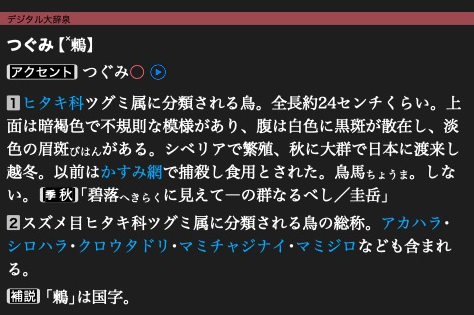

# Read articles and headlines

[](../assets/guide/daijisen-article.png)

大辞泉’s 鶫 article is an XML document rendered by the app.

These snippets use the open `dictionary` from [Open a dictionary](products.md).

## Read an article

Read the first stored article, or use a page ID obtained from a search result:

=== "Python"

    ```python
    first_id = dictionary.entries.id_at(0)  # No payload read.
    text = dictionary.entry_xml(first_id)
    ```

=== "C++"

    ```cpp
    auto firstId = dictionary->entries()->idAt(0).value();
    auto text = dictionary->entryUtf8ById(firstId).value();
    ```

The returned text is an owning string. This example assumes the selected
dictionary contains articles.

## Walk through articles

=== "Python"

    ```python
    if dictionary.entries is not None:
        for page in dictionary.entries:
            page_id = page.id
            xml = page.data.utf8()
    ```

=== "C++"

    ```cpp
    for (auto item : dictionary->entryItems()) {
        const auto& page = item.value();
        uint32_t pageId = page.itemId;
        auto xml = page.data.utf8().value();
        // xml borrows page.data. Process it before page leaves scope.
    }
    ```

Each step reads or decompresses one page. Earlier pages are not kept unless you
retain them. Page IDs may have gaps. Storage order can differ from browsing
order in the app.

## Read a target's headline

=== "Python"

    ```python
    target = mkd.EntryId(first_id)
    headline = dictionary.headline_for_entry_id(target)
    ```

=== "C++"

    ```cpp
    const MKD::EntryId target{firstId, 0};
    auto headline = dictionary->headlineForEntryId(target).value();
    ```

A target may identify a passage inside an article. Use its page ID to read the
whole XML document and retain the full target to locate the passage. Headline
text can contain encoded headline commands. See [formatted headlines](../reference/indexes.md#decode-a-headline).

For byte views without an extra copy, see [buffers and ownership](../reference/buffers.md).

Next: [Read media and fonts](resources.md).
