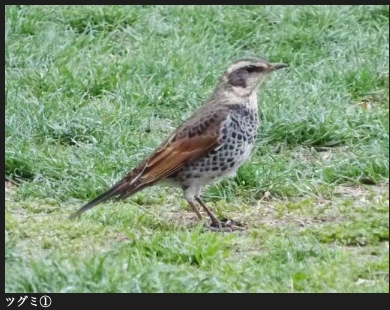
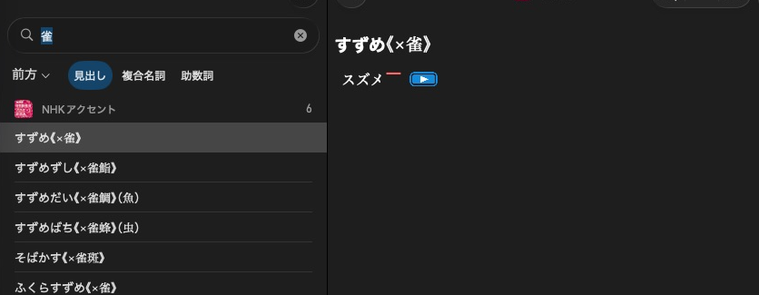

# Read media, fonts and stylesheets

[](../assets/guide/daijisen-graphic.png)

大辞泉 includes a photograph in its 鶫 article.

[](../assets/guide/nhk-suzume.png)

NHKアクセント provides a playback control beside the pronunciation of すずめ.

Use the dictionary opened in [Open a dictionary](products.md).

## Read graphics and audio

=== "Python"

    ```python
    if dictionary.graphics is not None:
        graphics = dictionary.graphics
        name = graphics.id_at(0)
        data = graphics.get(name)

    if dictionary.audio is not None:
        for clip in dictionary.audio:
            print(clip.id, len(clip.data))
    ```

=== "C++"

    ```cpp
    if (const auto* graphics = dictionary->graphics()) {
        for (size_t i = 0; i < graphics->size(); ++i) {
            auto name = graphics->idAt(i).value();
            auto data = graphics->get(name).value();
        }
    }
    if (const auto* audio = dictionary->audio()) {
        std::visit([](const auto& store) {
            for (auto item : store.items()) {
                auto data = item.value().data;
            }
        }, *audio);
    }
    ```

Graphics have string IDs. Audio may have string IDs or numeric IDs in legacy
stores. Both Python store types use the same sequence and `get(id)` interface.
Absent stores are null pointers / `None`.

For a known content-relative path, use `resource("gaiji/rare.svg")` or
`resource("graphics/bird.svg")`. This also maps loose assets. It is not a recursive
file listing and does not resolve numeric legacy audio IDs.

## Read fonts and stylesheets

=== "Python"

    ```python
    for font in dictionary.fonts:
        font.write_to(output_directory / font.filename)

    if dictionary.stylesheet is not None:
        text = dictionary.stylesheet.data
    ```

=== "C++"

    ```cpp
    for (const auto& font : dictionary->fonts())
        font.writeTo(outputDirectory / font.filename()).value();
    if (const auto* css = dictionary->stylesheet()) {
        auto text = css->data();
    }
    ```

A font can be an ordinary mapped file or several packed fragments. Opening
identifies its format and resolves `filename()` / `filename`,
including `.ttf`, `.otf` or `.ttc`. `name()` / `name` is the resource name without
that extension.

Path writes stream the fragments, return the byte count and refuse existing
files. The output directory must already exist. Partial new files are removed
if writing fails. To use an already open Python file, retain direct buffer access:

```python
with open(output_directory / font.filename, "wb") as output:
    for fragment in font:
        output.write(fragment)
```

The C++ stream overload and `fragments()` remain available. Both approaches avoid
assembling a contiguous font buffer. Night-mode CSS is available through
`nightmodeStylesheet()` / `nightmode_stylesheet`.

Next: [Browse navigation indexes](navigation.md).
