# Article CSS

For examples in context, see [Styling articles](../creating/styling.md).
Rendered results are screenshots from Monokakido 1.4.6.

## Layout and appearance

| Feature | Syntax and use                                                                                                                                                   | Rendered |
| --- |------------------------------------------------------------------------------------------------------------------------------------------------------------------| --- |
| Writing direction | `body { writing-mode: vertical-rl; }`. The parser also accepts `horizontal-tb` and `vertical-lr`. Set the article direction on `body`.                           | 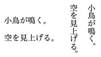 |
| Horizontal group | `text-combine-horizontal: all` keeps a short span together. `none` restores normal orientation. Apply `all` to the number or label, not the whole paragraph.     | 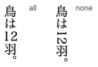 |
| Upright characters | `text-combine-horizontal: full-width` makes individual Latin letters and digits upright. It does not rewrite them as full-width Unicode characters.              | 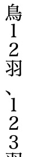 |
| Warichu | `display: warichu; font-size: 0.5em` divides an annotation into two small lines.                                                                                 |  |
| Ruby | `display: ruby`, `ruby-base`, `ruby-text` style the container, base and reading. Use [ruby markup](../creating/inline_content.md#add-ruby).                      | 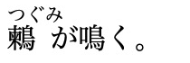 |
| Gaiji images | `display: gaiji; height: 1.1em` gives an image text-like placement and colouring. See [gaiji registration](../creating/inline_content.md#register-a-gaiji-image). |  |
| Mathematics | `display: math` interprets formula text. See the [notation reference](mathematics.md).                                                                           |  |
| Hanging marker | `display: hang` places a marker outside the paragraph's text edge.                                                                                               |  |
| Arrow border | `border-shape: arrow-box` or `arrow-box-lr` points one way, `arrow-box-rl` the other. `default` restores an ordinary border.                                     |  [Official example](../creating/styling.md#arrow-shaped-labels) |
| Pitch accent | `text-decoration: accent` draws a high-pitch line and final drop.                                                                                                |  |
| Midpoint dot | `text-decoration: midpoint` puts one dot at the middle of the decorated span, not one dot per character.                                                         | 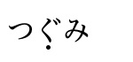 |
| Decoration colour and width | `text-decoration-color: #175C80; text-decoration-width: 0.12em` adjusts a decoration.                                                                            | 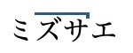 |
| Font glyph | `glyph: 11307` selects a glyph ID in the current font. It is not a Unicode code point.                                                                           |  |
| Font feature | `glyph-form: ital` selects one four-character OpenType feature tag. Other tags, such as `jp90`, depend on the font.                                              |  |
| Named and night colours | `@color birb-blue = #175C80;` defines a name for `color`, `background-color` and borders. Override the name in the sibling `-nightmode.css` stylesheet.          |  |
| Image scale | `img { zoom: 60%; }` scales the image's natural dimensions before fitting it to the available space. `normal` restores 100%. This does not scale ordinary text.  | 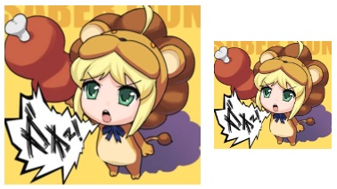 |

## Selection & copying

These controls only affect interaction.

| Property | Behaviour | Rendered |
| --- | --- | --- |
| `word-select: word` | Expands a word selection. | 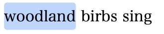 |
| `word-select: character` | Suppresses word expansion. Double-clicking no longer selects the whole word. | 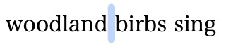 |
| `user-select: none` | Prevents selection of the span. `text` allows it, `auto` uses the default. The `-webkit-user-select` is also accepted. | 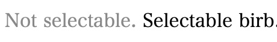 |
| `user-select: nocopy` | Leaves text visible but excludes it from copied text. Copying this paragraph yields only `Copied birb.` | 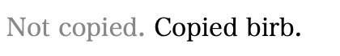 |
| `speech: disabled` / `enabled` | Excludes or includes text in native read-aloud. Here playback begins with `The`, skipping `Silent birb.` | 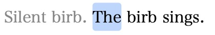 |
