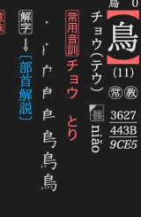
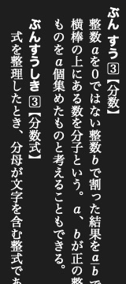
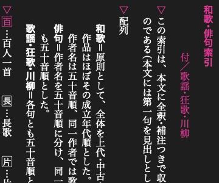
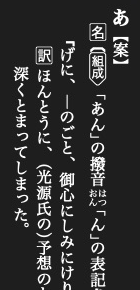
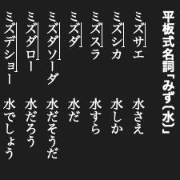
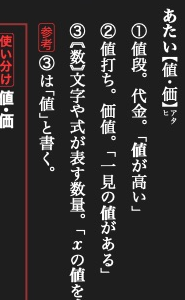

# Article layout examples

Short XML and CSS examples for the [article CSS reference](article_css.md).
Add these rules to an [article stylesheet](../authoring/styling.md).

## Compact readings with warichu


旺文社漢字典「鳥跡・鳥迹」, within「鳥」. Both readings fill the two small columns.

```xml
蒼頡<mlg>ソウケツ・ ソウキツ</mlg>
```

```css
mlg {
    display: warichu;
    font-size: 0.5em;
}
```

Warichu divides a short annotation into two compact lines. It is useful for
readings and parenthetical notes. It is separate from ruby, which attaches a
reading to base text.

## Images that behave like text



旺文社漢字典「鳥」. The small image beside `niǎo` is an inline gaiji.

```xml

```

```css
img.字韻 {
    display: gaiji;
    height: 1.1em;
    text-combine-horizontal: all;
}
```

`display: gaiji` gives an image text-like placement. Set its height in `em` to
follow the surrounding font size. Monochrome gaiji can follow the text colour,
including night-mode colours. Keep ordinary illustrations as ordinary images.

For your own glyphs, use [gaiji registration](../authoring/gaiji.md#register-and-encode-the-glyph).

## Mathematical expressions



大辞林「分数」. Both fractions remain upright within the vertical text.

```xml
<math>\frac{a}{b}</math>
```

```css
math {
    display: math;
    text-combine-horizontal: all;
}
```

The layout engine passes the formula text to its mathematical renderer. This example draws
a fraction. The input is formula notation, rather than a MathML element tree.

## Hanging markers



旺文社古語辞典「和歌・俳句索引」. The ▽ markers sit outside the text columns.

```xml
<p><M_hang>▽</M_hang>鳥の読みから項目を探します。</p>
```

```css
M_hang {
    display: hang;
    margin-right: 0.2em;
    color: okg-red;
}
```

`display: hang` puts a marker outside the paragraph's text edge. Wrapped lines
align with the text rather than the marker. Here `okg-red` is a named colour,
[defined in the stylesheet](../authoring/styling.md#colours-and-night-presentation).

## Arrow-shaped labels



旺文社古語辞典「あ【案】」.

```xml
<M_mark class="組成">組成</M_mark>
```

```css
M_mark.組成 {
    border: solid 1px black;
    border-shape: arrow-box;
    padding-right: 0.5em;
}
```

`border-shape: arrow-box` turns the label's border into an arrow-shaped outline.
Use `arrow-box-rl` for the opposite arrow direction.

## Pitch-accent marks



大辞林「文節・活用形のアクセント例」. The line marks ズサ in ミズサエ.

```xml
ミ<sl>ズサ</sl>エ
```

```css
sl { text-decoration: accent; }
```

`text-decoration: accent` draws a line along the high-pitch part, with a short
stroke marking the drop at its end. The line follows the writing direction.

## Font glyphs and features


新明解国語辞典「鶫」. The boxed zero is selected by `glyph`.

### Select a glyph

```xml
<accent0>⓪</accent0>
```

```css
accent0 { glyph: 11307; }
```

`glyph` selects a glyph number in the current font. 新明解 uses this for its
accent symbols. The number is font-specific, not a Unicode code point. Prefer
ordinary Unicode or [gaiji](../authoring/gaiji.md) unless you control the font.

### Select a font feature



旺文社国語辞典「値・価」. The variable `x` uses the font's italic form.

```xml
「<ital>x</ital>の値を求める」
```

```css
ital { glyph-form: ital; }
```

`glyph-form` selects an OpenType feature by its four-character tag. The font
must provide that feature. Installed dictionaries also use `jp90` for Japanese
character forms.

## Ruby presentation

Ruby markup comes from [Add ruby](../authoring/ruby.md#add-ruby). Style its
reading with the Dictionaries display rules:

```css
rt {
    display: ruby-text;
    font-size: 0.55em;
}
```

To hide optional readings in the normal stylesheet, use `rt { display: none; }`.
A [full-ruby stylesheet](../authoring/ruby.md#configure-full-ruby-presentation) can
restore `display: ruby-text` when the reader enables that presentation. It styles
readings already in the XML, it does not generate them.
