# Mathematical notation

Use formula text inside an element with `display: math`. This is a small math language with TeX-like syntax.

```xml
<math>\frac{a}{b}</math>
```

```css
math { display: math; text-combine-horizontal: all; }
```

Every result below is cropped from Monokakido 1.4.6.

## Formatting

| Feature | Formula text | Result in Dictionaries |
| --- | --- | --- |
| Fraction | `\frac{a}{b}` | 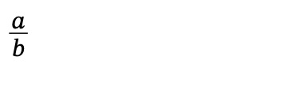 |
| Subscript and superscript | `x_{i}^{2}` | 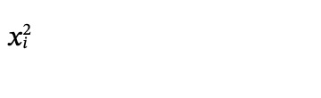 |
| Square and indexed roots | `\sqrt{x}+\sqrt[3]{y}` | 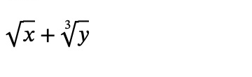 |
| Large operators | `\prod_{i=1}^{n}x_i+\sum_{i=1}^{n}i` | 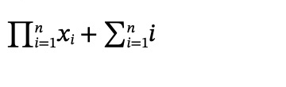 |
| Integrals | `\int_{0}^{1}x^2` | 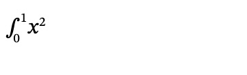 |
| Accents | `\hat{x}+\bar{x}+\dot{x}` | 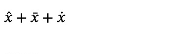 |
| Vector arrows | `\vec{a}+\overleftarrow{AB}` | 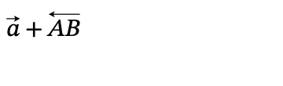 |
| Font faces | `\mathrm{ABC}+\boldsymbol{ABC}+\text{birb}` | 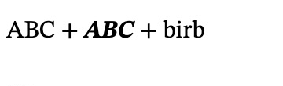 |
| Formula style | `\displaystyle\frac{a}{b}+{\scriptstyle\frac{a}{b}}` | 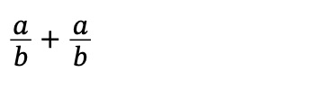 |
| Symbols and relations | `\alpha+\beta\leq\infty` | 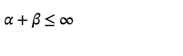 |
| Spacing | `a\!b+a\,b+a\;b` | 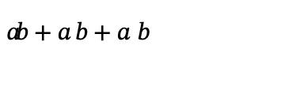 |
| Aligned lines | `\begin{split}a&=b+c\\d&=e\end{split}` | 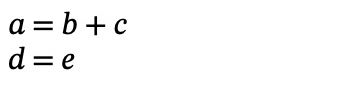 |
| Local macro | `\newcommand{\birb}[1]{\frac{#1}{2}}\birb{x}` | 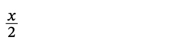 |

Braces group an argument. `_` and `^` attach to the preceding expression.
Inside `split`, `&` marks alignment and `\\` or `\cr` starts another line.
Escape `&` as `&amp;` in article XML.

The renderer also recognises `\textstyle` and `\scriptscriptstyle`, additional
integrals such as `\iint`, and accents such as `\acute`, `\grave`, `\breve`,
`\check`, `\tilde`, `\ddot`, `\dddot`, `\ddddot`, `\widehat` and `\widetilde`.
Vector forms include `\overrightarrow` and `\overleftrightarrow`.

[Symbol command list](../assets/reference/math-symbols.txt) lists the named
symbols with glyph definitions in the supported math command families.
It is a lookup aid, not a list of TeX packages or environments.

## Limits

Unknown commands can disappear silently while their arguments remain visible.
For example, `\binom{n}{k}+\frac{n}{k}` renders as:

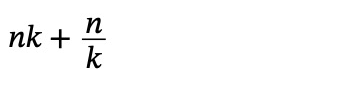

Keep `text-combine-horizontal: all`on the formula when it should remain upright in vertical articles.
