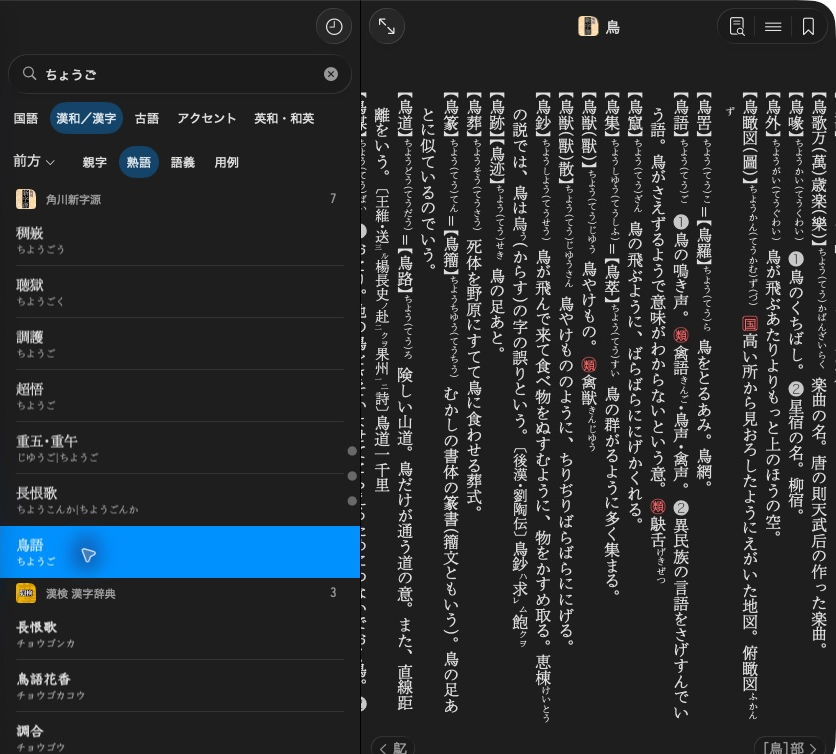

# Choose scopes and matching



KJT’s 熟語 scope finds 鳥語 inside the 鳥 article.

## Choose a search scope

A scope selects what kind of material to search. These are the common choices:

| Scope | Use it for |
| --- | --- |
| `Headword` | Entry spellings and readings. Kanwa dictionaries use it for parent kanji entries. |
| `Idiom` | Phrases and idioms, or jukugo in kanwa dictionaries |
| `Example` | Example sentences and quotations |
| `Sense` | Keys associated with meanings or definitions |
| `Kanji` | Kanji lookup in dictionaries that provide it |

Names here use C++ spelling. Python uses uppercase names such as `HEADWORD`.
Ask the dictionary which scopes are available:

=== "Python"

    ```python
    available_scopes = search.scopes(fallback=mkd.SearchFallback.DICTIONARY_RULES)
    examples = search.search("鳥", scope=mkd.SearchScope.EXAMPLE)
    ```

=== "C++"

    ```cpp
    auto availableScopes = search.scopes(MKD::SearchFallback::DictionaryRules);
    auto examples = search.search("鳥", {.scope = MKD::SearchScope::Example}).value();
    ```

See the [scope reference](../reference/search_profiles.md) for other indexes and authoring support.

## Prefix and suffix matching

Use `match` to choose prefix, suffix or exact lookup. Set `fallback` to `None`
when you want the match and scope to stay fixed. The default, `DictionaryRules`, can try
variations according to the dictionary's rules.

=== "Python"

    ```python
    beginning = search.search(
        "つぐ", match=mkd.SearchMode.PREFIX, fallback=mkd.SearchFallback.NONE,
    )
    ending = search.search(
        "ぐみ", match=mkd.SearchMode.SUFFIX, fallback=mkd.SearchFallback.NONE,
    )
    ```

=== "C++"

    ```cpp
    auto beginning = search.search("つぐ", {
        .match = MKD::SearchMode::Prefix,
        .fallback = MKD::SearchFallback::None,
    }).value();

    auto ending = search.search("ぐみ", {
        .match = MKD::SearchMode::Suffix,
        .fallback = MKD::SearchFallback::None,
    }).value();
    ```

Both queries can find `つぐみ` when that key is present. Prefix matching compares
the start of a key, suffix matching its end. Records marked exact-only are
excluded from prefix and suffix results. An absent required index yields no matches.

## Request an exact lookup without broadening

=== "Python"

    ```python
    exact = search.search(
        "つぐみ",
        scope=mkd.SearchScope.HEADWORD,
        match=mkd.SearchMode.EXACT,
        fallback=mkd.SearchFallback.NONE,
    )
    ```

=== "C++"

    ```cpp
    auto exact = search.search("つぐみ", {
        .scope = MKD::SearchScope::Headword,
        .match = MKD::SearchMode::Exact,
        .fallback = MKD::SearchFallback::None,
    }).value();
    ```

Exact lookup still normalises the query using the dictionary's rules. It does
not require byte-for-byte equality with the stored key.

With `DictionaryRules`, an unsuccessful exact lookup may retry as a prefix lookup.
A headword query may also try idioms or examples. Use `None` to skip these retries
and dictionary-specific query expansion.

Next: [Understand dictionary-specific search rules](dictionary_rules.md).
